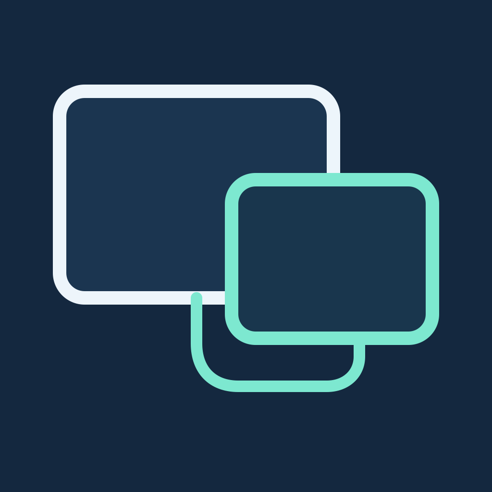

[简体中文](README.md) | [English](README.en.md)

# WireView



Turn an Android tablet into a wired secondary display for your Mac. WireView focuses on USB transport and low latency. The current version is a **0.1.0 development preview**.

[](https://github.com/martinh4cker/wire-view/releases/latest)
[](LICENSE)

> Current support: **Apple silicon Mac → Android**. A Windows host is planned, but not implemented.

## Features

- Creates an independent macOS extended desktop while preserving the primary display and existing monitor layout; can also mirror a connected Mac display.
- Streams H.264 over USB using USB debugging and `adb reverse`; no Wi-Fi or external server is used.
- Selects the Android device, size, bitrate, and frame-rate target from the macOS menu bar. Settings and display placement are saved per device.
- In the current source, unplugging USB stops sharing and removes the virtual display. Reconnect the tablet and select **Start display** to use its saved settings and placement. The Mac menu and Android receiver support Simplified Chinese and English, following each device's system language.

## Download: 0.1.0

Download from [GitHub Releases](https://github.com/martinh4cker/wire-view/releases/tag/v0.1.0):

See the [v0.1.0 release notes](docs/releases/v0.1.0.md) and [changelog](CHANGELOG.md).

- **Mac (Apple silicon)**: [WireView-0.1.0-macOS-arm64.zip](https://github.com/martinh4cker/wire-view/releases/download/v0.1.0/WireView-0.1.0-macOS-arm64.zip)
- **Android**: [WireView-0.1.0-Android.apk](https://github.com/martinh4cker/wire-view/releases/download/v0.1.0/WireView-0.1.0-Android.apk)
- Checksums: [SHA256SUMS.txt](https://github.com/martinh4cker/wire-view/releases/download/v0.1.0/SHA256SUMS.txt)

This is a development preview. The Mac app is ad-hoc signed and not notarized. The Android APK uses a development signing key and is not intended for Google Play. If Gatekeeper blocks the Mac app on first launch, Control-click it in Finder and choose **Open**.

### Install

1. Unzip the Mac download, move `WireView.app` to Applications, and open it.
2. Install the APK on the Android tablet. With USB debugging enabled, you can install it with:

   ```sh
   adb install -r WireView-0.1.0-Android.apk
   ```

3. Connect the tablet by USB, enable USB debugging, and authorize this Mac. Open WireView on Android, then click the Mac menu-bar icon → **Start display**. macOS will ask for screen-recording permission the first time.

### Touch control (current source)

Build and update both apps from the same source. Touch is enabled by default in **Extended desktop** once WireView has permission in **Privacy & Security → Accessibility**. Tap to click, hold and move to drag, or swipe with two fingers to scroll.

Swipe left or right with three fingers to change Spaces. A left swipe advances to the Space on the right. Swipe up with three fingers for Mission Control or down for the current app’s windows. Swipe left with four fingers to switch to the next app and right to switch in reverse. These gestures use macOS default shortcuts. Space switching requires a neighboring Space and the corresponding shortcuts enabled in System Settings.

## Build from source

### Requirements

- Apple silicon Mac, macOS 15 or later, and Xcode Command Line Tools with the macOS 15 SDK
- Android SDK Platform 35, Build-Tools 35.0.0, JDK 17, and Android Platform-Tools
- Android 8 / API 26 or later with H.264 support and authorized USB debugging

Set the Android SDK path if it is not installed in the default location:

```sh
export ANDROID_SDK_ROOT="$HOME/Library/Android/sdk"
export JAVA_HOME="$(/usr/libexec/java_home -v 17)"
export PATH="$JAVA_HOME/bin:$PATH"
```

Build:

```sh
make build       # Build into .build/
make release     # Build and collect artifacts in release/
```

The build uses the system Swift toolchain and Android SDK; no Gradle or third-party app libraries are required. Signing keys stay in the Git-ignored `.build/` directory and must not be committed.

## Defaults and performance

The default is 1920×1200 at a 60 fps target and 10 Mbps. The menu also offers 1280×800 / 4 Mbps and 2560×1600 / 20 Mbps. 90/120 fps are experimental targets, not guaranteed presentation rates. Actual results depend on Mac capture and encoding, USB transport, Android decoding, and the tablet refresh mode.

A generated test pattern reached about 60 fps at 1280×800 / 4 Mbps on one Android 13 tablet. Real desktop capture, other quality settings, and other tablet models have not all been verified. The pipeline is `ScreenCaptureKit → VideoToolbox → USB/ADB reverse → MediaCodec → SurfaceTexture/OpenGL`. See the [performance notes](docs/performance.md) and [architecture and protocol](docs/architecture.md).

## Known limitations

- The macOS virtual display uses the private `CGVirtualDisplay` interface and may need updates after macOS changes.
- Testing so far covers Apple silicon Mac and one Android 13 tablet; compatibility with other devices is not yet established.
- Native multi-touch, audio, simultaneous streaming to multiple tablets, and a Windows host are not implemented.
- Stable real-world 90/120 fps presentation has not been verified.

## Development and contributions

- `make test`: run local automated tests.
- `make test-video`: exercise the generated test pattern on one authorized USB tablet; it does not capture the desktop.
- Read the [contribution guide](CONTRIBUTING.md) and [security notes](SECURITY.md) before contributing.
- Bug reports and feature requests are welcome in [Issues](https://github.com/martinh4cker/wire-view/issues).

## License

[MIT License](LICENSE).
