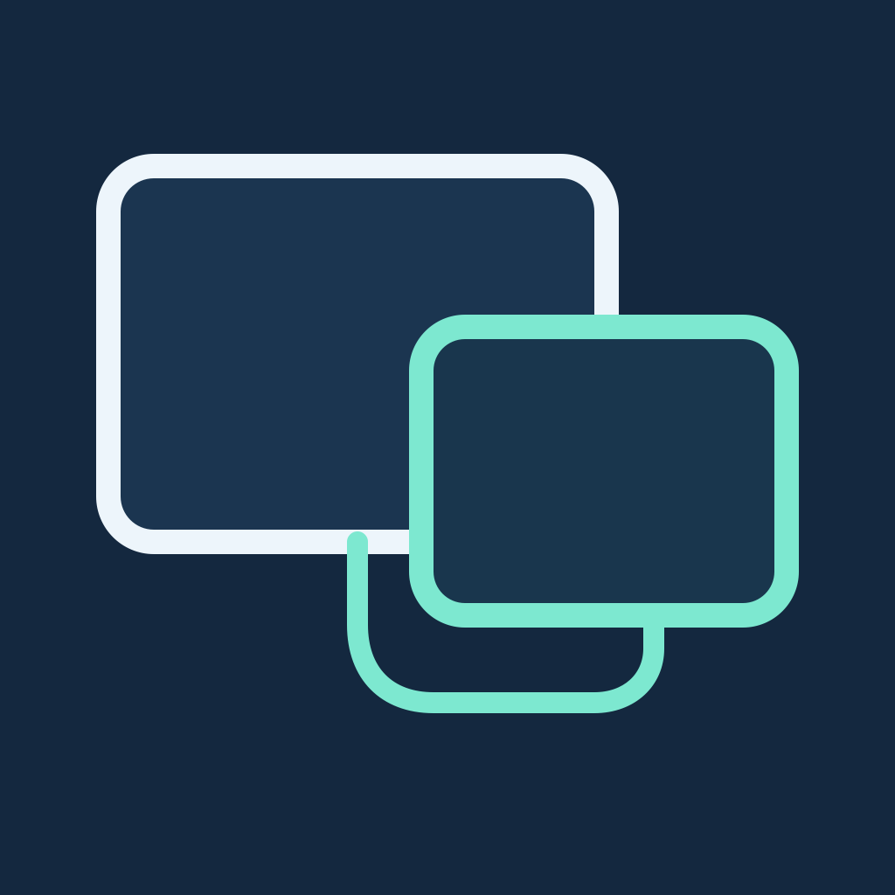

[简体中文](README.md) | [English](README.en.md)

# WireView



用 USB 数据线将 Android 平板变成 Mac 的扩展显示器。WireView 优先保证有线传输和低延迟；当前版本是 **0.1.0 开发预览版**。

[](https://github.com/martinh4cker/wire-view/releases/latest)
[](LICENSE)

> 当前支持 **Apple 芯片 Mac → Android**。Windows → Android 尚未实现，属于后续路线。

## 功能

- 创建独立的 Mac 扩展桌面，保留主屏和其他显示器的排列；也可镜像已连接的 Mac 屏幕。
- 通过 USB 调试和 `adb reverse` 传输 H.264 视频，不经过 Wi-Fi 或外部服务器。
- 在菜单栏选择 Android 设备、尺寸、码率和帧率；每台设备分别保存配置与屏幕位置。
- 本地新版会在拔线时停止共享并移除虚拟副屏。插回后保留设备配置和排列，点「开始显示」重新连接。Mac 菜单和 Android 接收端支持简体中文、英文，并跟随各自系统语言。

## 下载：0.1.0

从 [GitHub Releases](https://github.com/martinh4cker/wire-view/releases/tag/v0.1.0) 下载：

发布内容见 [v0.1.0 Release notes](docs/releases/v0.1.0.md)，历史变更见 [CHANGELOG](CHANGELOG.md)。

- **Mac（Apple 芯片）**：[WireView-0.1.0-macOS-arm64.zip](https://github.com/martinh4cker/wire-view/releases/download/v0.1.0/WireView-0.1.0-macOS-arm64.zip)
- **Android**：[WireView-0.1.0-Android.apk](https://github.com/martinh4cker/wire-view/releases/download/v0.1.0/WireView-0.1.0-Android.apk)
- 校验和：[SHA256SUMS.txt](https://github.com/martinh4cker/wire-view/releases/download/v0.1.0/SHA256SUMS.txt)

这是开发预览版：Mac App 使用 ad-hoc 签名且未公证；Android APK 使用开发签名，不适用于 Google Play。首次打开 Mac App 时，如果 Gatekeeper 阻止启动，请在 Finder 中按住 Control 点按 App，再选择「打开」。

### 安装

1. 解压 Mac ZIP，将 `WireView.app` 放入「应用程序」并打开。
2. 在 Android 平板上安装 APK。可使用 USB 调试安装：

   ```sh
   adb install -r WireView-0.1.0-Android.apk
   ```

3. 用数据线连接平板，确认 Android 已开启 USB 调试并允许这台 Mac。打开平板上的 WireView，再点 Mac 菜单栏图标 →「开始显示」。首次使用需允许屏幕录制权限。

### 触摸控制（当前源码）

用同一份源码构建并更新两端后，触摸在「扩展桌面」默认可用。首次使用时在 macOS「隐私与安全性 → 辅助功能」允许 WireView。单指轻点为左键，按住移动为拖拽，双指滑动为滚动。镜像和测试画面仅显示画面。

三指向左滑进入右侧桌面，向右滑进入左侧桌面。三指向上打开调度中心，向下显示当前 App 的窗口。四指向左切到下一个 App，向右反向切换。手势沿用 macOS 默认快捷键，需要预先创建相邻桌面，并在系统设置启用对应的调度中心快捷键。

## 从源码构建

### 环境

- Apple 芯片 Mac，macOS 15 或更新版本，Xcode Command Line Tools（macOS 15 SDK）
- Android SDK Platform 35、Build-Tools 35.0.0、JDK 17、Android Platform-Tools
- Android 8 / API 26 或更新版本的平板，支持 H.264 并已授权 USB 调试

设置 Android SDK 路径（若未安装在默认位置）：

```sh
export ANDROID_SDK_ROOT="$HOME/Library/Android/sdk"
export JAVA_HOME="$(/usr/libexec/java_home -v 17)"
export PATH="$JAVA_HOME/bin:$PATH"
```

构建：

```sh
make build       # 构建到 .build/
make release     # 构建并整理到 release/
```

构建脚本使用系统 Swift 工具链和 Android SDK，不需要 Gradle 或第三方应用依赖。签名密钥仅保存在被 Git 忽略的 `.build/`，不要提交。

## 默认设置与性能

默认使用 1920×1200、60 fps、10 Mbps。菜单还提供 1280×800 / 4 Mbps 和 2560×1600 / 20 Mbps。90/120 fps 是实验性目标值，不代表实测呈现帧率；实际结果取决于 Mac 采集与编码、USB 链路、Android 解码以及平板刷新模式。

在一台 Android 13 平板上，1280×800 / 4 Mbps 测试图约 60 fps；真实桌面、其他画质和其他型号尚未逐一验证。实现使用 `ScreenCaptureKit → VideoToolbox → USB/ADB reverse → MediaCodec → SurfaceTexture/OpenGL`。更多测量数据见[性能记录](docs/performance.md)，数据格式见[架构与协议](docs/architecture.md)。

## 已知限制

- Mac 虚拟扩展屏使用 macOS 私有 `CGVirtualDisplay` 接口，系统升级后可能需要适配。
- 目前仅验证 Apple 芯片 Mac 和一台 Android 13 平板；其他 Android 设备的兼容性尚未确认。
- 尚不支持原生多点触摸、音频、同时向多台平板输出，也尚无 Windows 主机实现。
- 90/120 fps 尚未验证为稳定的实际显示帧率。

## 开发与贡献

- `make test`：运行本地自动化测试。
- `make test-video`：用一台已授权 USB 平板验证测试画面；不采集桌面。
- 贡献前请阅读[贡献指南](CONTRIBUTING.md)和[安全说明](SECURITY.md)。
- 欢迎提交 Bug 和功能建议：[Issues](https://github.com/martinh4cker/wire-view/issues)。

## 许可证

[MIT License](LICENSE)。
